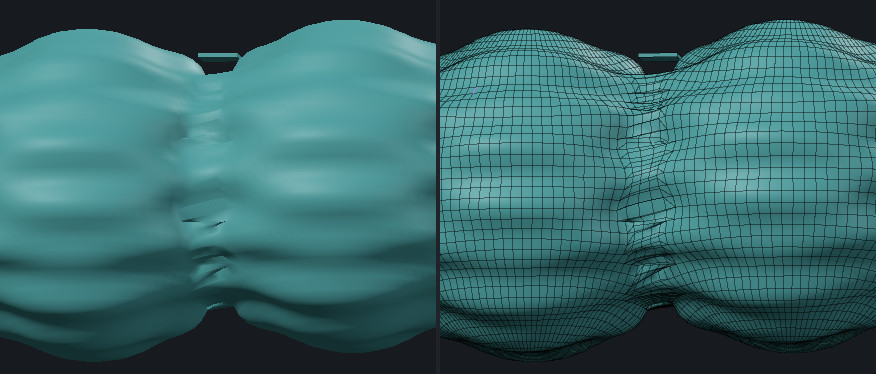
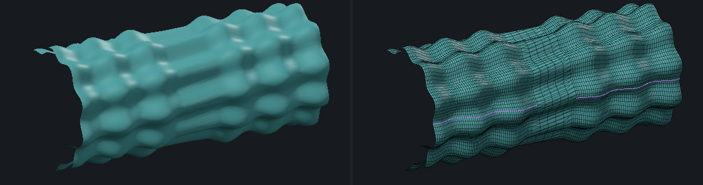

# Local mesh fusion validation

Implementation evidence for [#120](https://github.com/dustyghost/clay-form/issues/120) and [#121](https://github.com/dustyghost/clay-form/issues/121), 1 November 2026. These fixtures establish local preservation and the interaction flow. They are not an acceptance claim for every sculpt or every surface Boolean configuration.

## Preservation and transactions

`cargo test --locked --lib fusion -- --test-threads=1` runs the focused geometry and application tests. Coverage includes:

- 8/8, 8/12 and 7/13 open rims; several segment counts; alignment offset; different radii; rotated, offset and mildly nonplanar ends. Unselected holes remain unchanged and selected rim edges have exactly two incident triangles.
- Intersecting spheres, triangle-only versus mixed quad/triangle inputs, 48/36 source tessellation, two separated intersection pairs, and shallow overlap. Closed results have consistent edge winding and connected vertex fans.
- Exact source-index correspondence before compaction and an explicit old-to-new map through compaction. Retained positions, triangles/quads, material values, masks, vertex groups, face groups, hidden flags, UV corners/masks and crease/seam edges are compared.
- Closed joins cull enclosed shells. The fixtures compare a fusion with nested internal shells against the same fusion using only its exteriors, and close a bridge around a loose cube. A second cube inside the bounding box but outside the actual surface survives. A bridge with an unselected hole keeps the interior geometry. The app test checks the removal overlay, Apply, Undo and Redo.
- Obstructing faces, protected rims, inward-facing exterior shells, invalid options, malformed vertex fans, a small mesh budget and cooperative cancellation are rejected. A translated disjoint sphere case guards against numerical false contacts.
- Preview leaves document geometry/history/dirty state untouched; stale settings and stale scenes cannot apply. Apply is one Undo step, restores originals with Redo, survives project serialization, and retains hidden source subdivision stacks. Same-model joins are covered separately.

The existing equal-count Modeling bridge implementation is unchanged. Full tests, formatting, lint and GPU checks run in PR CI.

## Actual controls and visual review

The ignored `local_fusion_controls_offscreen_review` test runs in GPU CI. Locally it was rendered through the real egui/wgpu application using llvmpipe (Mesa 26.2.6, LLVM 23.1.4), one software-rendering thread, and an unoptimized Rust build. Pointer events select both viewport rims and click Preview/Apply/Cancel. The walkthrough checks Undo/Redo, closed intersection output and a 640×480 window. It does not replace a physical pen/driver check.

| Capture | Inspect |
| --- | --- |
| [Open ends before](01-open-ends-before.png) | Two separated sources and explicit hole selection |
| [Open ends preview](02-open-ends-preview.png) | Selected rims and the new connector; source surfaces remain in place |
| [Open ends wireframe](03-open-ends-wire.png) | Unequal boundary transition and untouched source quads |
| [Open ends applied](04-open-ends-applied.png) | Joined result after Apply, Undo and Redo |
| [Intersection preview](05-intersection-preview.png) | One local patch at the crossing of two closed surfaces |
| [Intersection wireframe](06-intersection-wire.png) | Retained source tessellation surrounding the patch |
| [Intersection applied](07-intersection-applied.png) | Shaded silhouette and local transition quality |
| [Compact window](08-small-window-controls.png) | Fixed action footer above floating viewport controls |

Colored rim and patch overlays show through surfaces to make the affected topology inspectable. Turn the overlay off or apply to assess the shaded surface. The cut follows source polygon boundaries, so jagged rims and local dimples can remain. Curvature shapes the connector without relaxing the retained sources. This is not an exact intersection curve or a global remesh.

To regenerate the images on a local Vulkan host:

```sh
CLAY_GPU_SOFTWARE=1 WGPU_BACKEND=vulkan LP_NUM_THREADS=1 \
CLAY_GUIDE_PREVIEW=docs/validation/local-fusion \
cargo test --locked --lib local_fusion_controls_offscreen_review -j 1 -- --ignored --nocapture --test-threads=1
```

## Geometry timing and peak resident memory

The opt-in `fusion_dense_source_profile` uses two outward UV spheres, centers separated by 1.7 units with a small Y/Z offset, a two-ring collar, two connector segments and zero curvature. This produces a small join while retaining most source triangles. Measurements below use the unoptimized geometry test process with debug information disabled; elapsed times exclude source creation and the UI/rendering/undo system. Peak RSS is the process high-water mark, cumulative across the three cases, not the operation's incremental allocation.

| Source triangles | Retained triangles | New patch triangles | Geometry time | Process peak RSS |
| ---: | ---: | ---: | ---: | ---: |
| 4,416 | 3,732 | 322 | 0.941 s | 32,840 KiB |
| 18,048 | 16,352 | 508 | 3.856 s | 41,532 KiB |
| 72,960 | 67,824 | 934 | 16.988 s | 76,512 KiB |

Commands were serialized under `/home/mark/.cache/codex-build.lock`, with one compiler job after checking host RAM and pressure. No release build or broad local suite was run.

The deeper-overlap 96-segment sphere experiment with a one-ring collar was rejected by connector intersection validation. A larger source density is not a promise that every collar setting succeeds. Invalid previews leave both sources intact and require a different collar, correspondence or overlap; there is no fallback to whole-mesh remeshing.

## UV-mapped source preparation, 21 November 2026

Both join modes combine source attributes. On `ea4b362`, each mapped triangle triggered a comparison of its source's complete saved UV topology against the current topology. The join now performs that check before the face loop.

| Combined source triangles | Before | After |
| ---: | ---: | ---: |
| 4,416 | 52 ms | 49 ms |
| 18,048 | 413 ms | 220 ms |
| 40,896 | 1,534 ms | 429 ms |

The manual `fusion_uv_merge_profile` measures the complete `fusion::merge` call on two UV spheres, including mesh validation and copying the geometry and UVs. Each size has three timed merges per revision. The table shows their medians on an i7-7500U under Linux, using Rust 1.99.0 and the unoptimised test profile. Fixture construction, intersection detection, stitching, viewport updates and Apply are outside the timed region.

```sh
cargo test --locked -j 1 --lib fusion_uv_merge_profile -- --ignored --nocapture --test-threads=1
```

The seam regression reproduced the stale-map error on the baseline. The focused cases now exercise pre-unwrap seams in both modes, removal of buried seams, mixed mapped and unmapped faces, incompatible texture bindings, and an open-end join through Apply, save/reopen and Undo/Redo.

## Detailed joins in the release build, 21 November 2026

The intersection fixture joins two closed, ridged parts with different tessellations and marked UV seams. A separate plate 0.024 model units thick sits above the seam. The component and face checks retain both sides of that plate and the source marks. The finished mesh has two connected components: the welded sculpt and the original plate.

The smaller 48/40-segment fixture also exercises a genuine obstruction. Widening the collar to two rings with five connector segments and curvature 0.5 takes the patch through the underside of the plate at y = 0.828. Preview identifies the collision with retained geometry. A connector that crosses its own faces gives a different diagnostic. The denser 96/88 fixture clears the plate at two rings, five segments and curvature 0.7.

For open ends, the two fluted parts have 96 and 112 vertices around the rims. The rendered check uses five segments, alignment offset 3 and curvature 0.7. A separate regression varies each control independently, restores a previous combination and compares the whole mesh. Mark confirmed that selecting both rims and using the join controls worked with his Huion pen.

### Surface deviation and visual review

For the 48/40 intersection, the test measures the distance to the nearer original sculpt surface at each patch triangle's three vertices and centroid. The plate is excluded from the distance query. The two source parts have a nominal radius of one model unit. These are sampled distances, with shared vertices counted per triangle.

| Extra rings | Segments | Curvature | Samples | RMS distance | Maximum distance |
| ---: | ---: | ---: | ---: | ---: | ---: |
| 1 | 4 | 0.5 | 2,720 | 0.05349 | 0.13590 |
| 1 | 5 | 0.7 | 3,496 | 0.04775 | 0.12769 |

The close-ups show the shaded preview on the left and the applied wireframe on the right. The ridged intersection stays closed and the plate is visible above it. Short creases remain where the patch follows a stepped source rim. The fluted connector follows the intended twist, with the original seam marks visible on either side. In both cases the applied mesh and all its attributes compare equal to the preview.





### Preview, Apply and cancellation in the application

Measured on Linux with an i7-7500U, Rust 1.99.0 and the release profile at `7e3695c`. Each row uses a fresh application test process with a 1100 × 780 egui/wgpu viewport and one llvmpipe rendering thread. Timing starts at command dispatch, after source discovery, and ends after the first completed rendered frame with the result. Peak RSS includes the renderer, document, undo history and test snapshots. The Apply reading is cumulative for that process. Each value is a single observed run.

| Scene | Source triangles | Preview | Preview peak RSS | Apply | Apply peak RSS |
| --- | ---: | ---: | ---: | ---: | ---: |
| Ridged intersection and plate | 16,604 | 807 ms | 215,984 KiB | 137 ms | 236,748 KiB |
| Fluted open ends | 26,624 | 489 ms | 228,236 KiB | 194 ms | 263,032 KiB |
| Fluted open ends, 144/160 sides and 160 axial steps | 97,280 | 1,668 ms | 324,848 KiB | 580 ms | 438,376 KiB |

The large open-end case rendered six frames during Preview. Cancelling a second preview after rendering a frame took 37 microseconds to dispatch. The next frame completed after 122 ms and the original scene and selection of the active model were restored. The two published fixtures and two saved sculpt-session projects passed the on-disk save/reopen and Undo/Redo comparisons. One additional saved sculpt contained intersecting input triangles and was rejected before Apply.

A separate refined-sphere scene exposed a false self-intersection on two nearly coplanar triangles that shared one corner. The regression uses the original six coordinates and also checks a real crossing away from a common corner and a folded coplanar pair.

### Reproduce the rendered checks

Run each case as a separate process to get an independent peak memory reading. The Linux examples use Vulkan with one software rendering thread. Set `CLAY_REVIEW_PROJECT` to use a saved two-source project. The open-ends profile selects the opening on each model nearest z = 0.

```sh
export CLAY_GPU_SOFTWARE=1 WGPU_BACKEND=vulkan LP_NUM_THREADS=1
export CLAY_GUIDE_PREVIEW=/tmp/local-join-review
cargo test --locked --release -j1 --lib fusion_rendered_relief_intersection -- --ignored --nocapture --test-threads=1
cargo test --locked --release -j1 --lib fusion_rendered_fluted_open_ends -- --ignored --nocapture --test-threads=1
cargo test --locked --lib fusion_relief_transition_deviation -- --nocapture
```

Intersection pairing requires mutually nearest simple loops. Arbitrary junctions, tangencies, coincident faces, containment without a crossing seam and inward-facing exterior shells remain unsupported.
