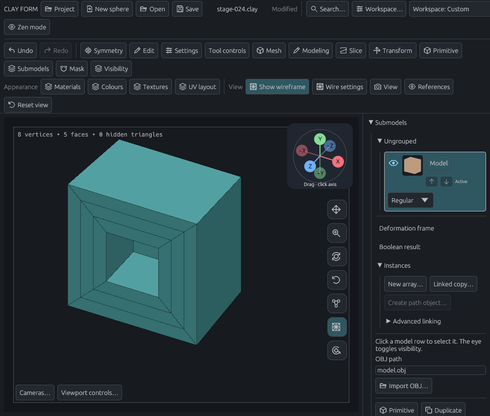
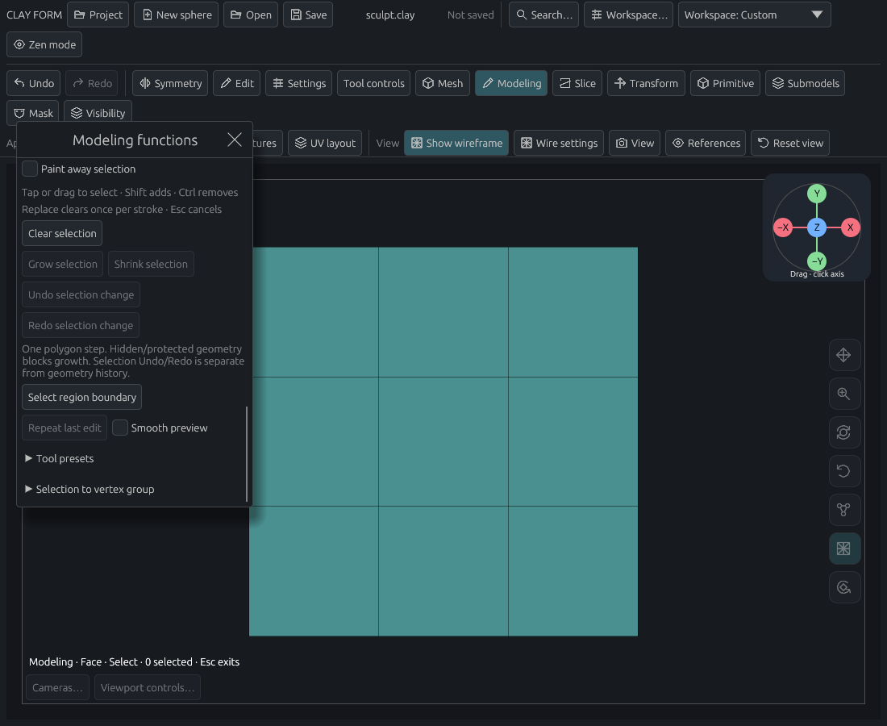
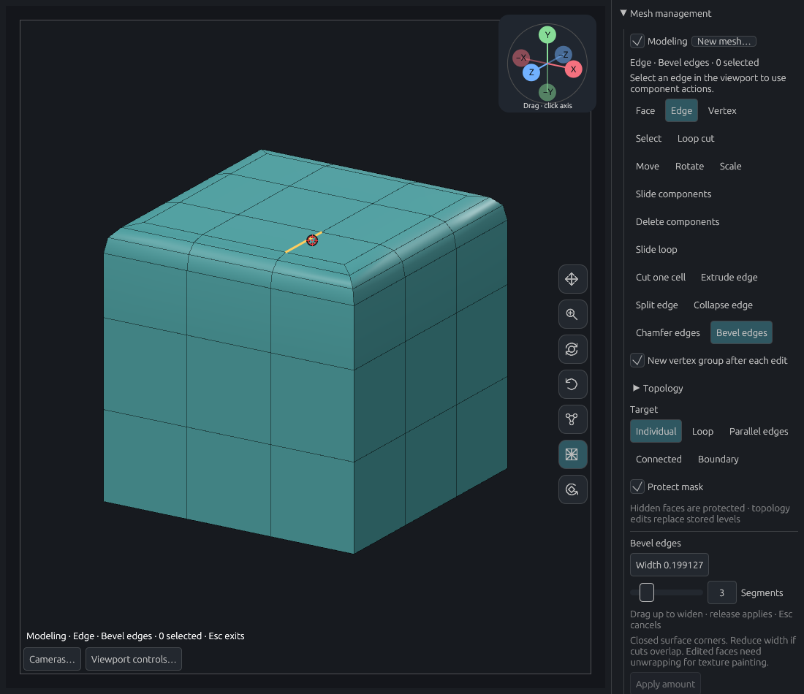

# Modeling acceptance notes — follow-up

This change follows PR #165 and addresses the notes from the November acceptance run. It includes fixes and requested improvements; it does not merge the stack.

## Verified changes

- Extrusion preserves valid cap UVs and marks new walls unmapped. Filling an old opening with an already inactive UV map is allowed; textures remain, but an unidentifiable old UV layout is not reassigned to different faces. Undo retains the original data.
- Wire-only meshes display their explicit edges without an invented outline.
- Rounded bevels on each sharp edge of a 3×3×3 cube succeed at 2 and 8 segments in the regression. Selected chains and complete loops now share rounded cross-section vertices between adjacent strips, preventing coincident caps at subdivision joins.
- Thickness supports Inward, Outward and Both, saves the direction, and no longer skews the saved open-box case through edge-order-dependent normal updates.
- Ctrl changes face/point extrusion between attached and detached during the drag, including reverting before release.
- Q supports dragging, Keep open, first-click viewport selection, shared tool settings and presets. Pinned menus leave viewport shortcuts available.
- Delete components works directly on the chosen component/target, with Keep unused vertices. Slide components supports individual faces/edges/vertices. Vertex mode has a Loop target.
- Ordinary transforms and both slide tools leave protected vertices fixed. Loop cutting/removal stops before protected areas. The stopping face may use triangles to preserve the shared boundary. Symmetry skips protected matching sets.

## Checks

Focused geometry and controller regressions cover these changes, including live pointer/modifier events, undo, saved settings, protected loop termination without cracks, and symmetry. Existing bevel, thickness, loop-removal and symmetry interaction checks passed locally. Full tests, lint, GPU interactions and packages run in PR CI.

Thin sliced hemispheres were also checked in all three directions at thicknesses 0.01–0.4, with surface/rim orientation preserved. A Vulkan check confirms preview and applied shell match. Local normal relaxation repairs folded slivers without changing the already-valid box result.

The saved thickness example was rendered using Vulkan/llvmpipe at thickness 0.3, 0.9 and 1.2. The 1.2 result was inspected against the original distorted capture. Q was rendered at 1100×900, including its scrolled settings and presets. Physical tablet input still needs acceptance testing.

## Connected bevel follow-up — 20 November

The user's loop-selection question exposed a distinct failure: a three-edge chain on the 3×3×3 cube passed with chamfer but failed with a two-segment bevel. Reusing the shared rounded cross-sections fixes the join without extending the selection to other edges. The regression checks that chain and the complete 12-edge top perimeter with 1, 2, 3 and 8 segments; every result is closed and consistently oriented.

The existing Vulkan control regression now also drags chamfer and bevel on the selected 12-edge loop. Preview, Escape, release-to-apply, grouping, Undo/Redo and save/reopen checks pass. The preview and applied captures were visually inspected; the rounded band continues around the selected perimeter. Vertex bevel retains its corner-rounding behaviour; it does not infer connecting edges from a vertex selection.

## Symmetry report still needs confirmation

The reported unchanged 3×3×3 cube failure has not reproduced in either New mesh or New Primitive → Convert. X symmetry selection and extrusion pass. Hidden-face mismatch no longer disables all symmetry; protected matching sets remain protected. If exact symmetry cannot match, Select remains available and the Modeling options explain the failure. The original report is not marked fixed without a successful user retest or a matching saved reproduction.
