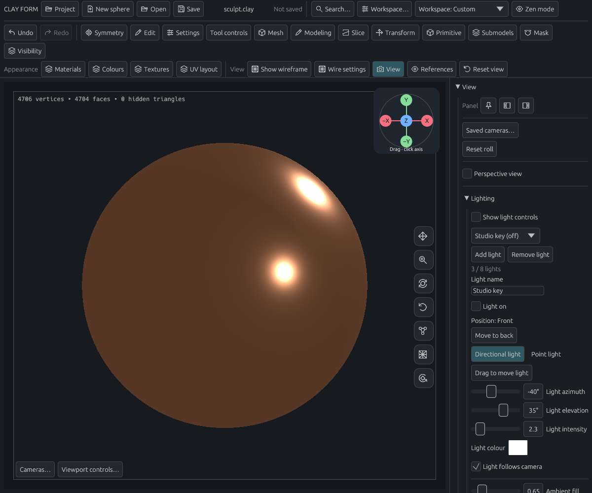

# Named light controls — 15 November 2026

Ticket: [#64](https://github.com/dustyghost/clay-form/issues/64).

Focused lighting tests passed (10 passed, 3 GPU/manual checks ignored by the ordinary filter). The software-GPU CPU/pixel comparison `gpu_lighting_types_colour_and_distance_match_cpu` passed with disabled lights interspersed through the rig and with every light disabled. Ambient fill remains independent. Serialization checks cover names, disabled state and migration from older saved lighting; optional light export omits disabled lights.

The real-control `viewport_lighting_offscreen_review` passed on Vulkan llvmpipe (LLVM 23.1.4, Mesa 26.2.6), with one software rendering thread. It renames a light through the text field, toggles it in both interfaces, selects lights by name, drags/cancels an orbit, switches sides, adjusts a point light, collapses/reopens the widget, and adds/removes lights. It also verifies that geometry and history remain unchanged. See [interaction.log](interaction.log).

Visual inspection confirmed readable name/on/off/position controls and a complete expanded point-light widget. The test caught and now guards against clipping after collapse/reopen. The widget scrolls when space is limited. The [guide screenshot](../../images/lighting-controls.png) shows both interfaces; the disabled state is shown below.

Commands used one Cargo compiler job under the shared build lock, with debug information and incremental compilation disabled. Full suite, lint, formatting and platform packaging are delegated to PR CI.
