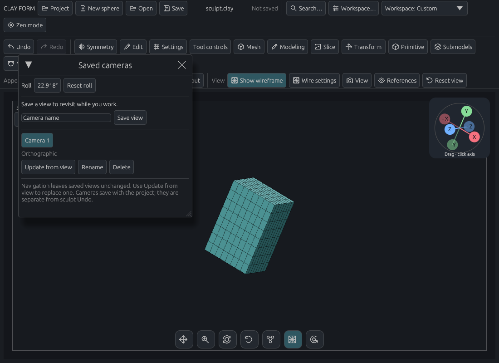
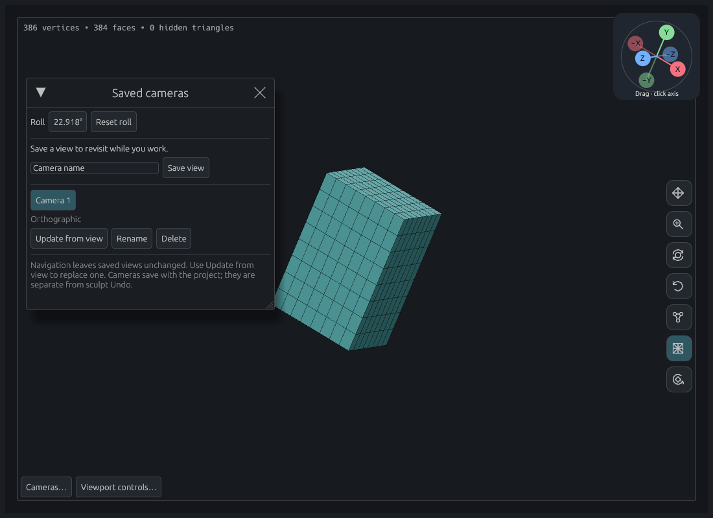
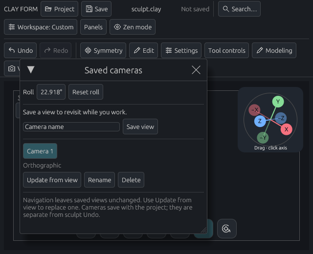

# Camera roll and saved views

Scope: #130 and #132. Based on PR #146, branch `feat/interaction-shortcuts` at `51b0ce0`.

## Try the workflow

1. Drag **Roll view** in either direction. Double-click it or choose **View → Reset roll** to straighten the view without resetting direction, pan, zoom or projection. The **Cameras…** window also has a numeric roll control.
2. Open **Cameras…** in the viewport, enter a name and click **Save view**. Click its name after navigating to restore orientation including roll, pan, zoom, projection, field of view and perspective distance.
3. Use **Update from view** explicitly to replace a bookmark. Rename it with **Rename → Apply name**. Delete offers **Delete camera** and **Keep camera**.
4. Save and reopen the project. Named cameras remain available; recovery copies include them too. The camera library starts empty for new and older projects.

The movable window also remains usable at 640 × 520. It occupies more of the drawing area in this compact layout; close or move it to inspect the whole model.

## Behaviour and limits

- Navigation leaves the library unchanged. Creating, updating, renaming or deleting a camera marks the project as changed. Bookmarks are project metadata, like reference-image placements, and are separate from sculpt Undo/Redo. Updating/deleting has no sculpt Undo step.
- The existing orbit pivot is the shared model-space origin. Pan is stored relative to the shorter viewport dimension so relative framing follows window/panel resizing. No movable pivot or model transform is introduced.
- Up to 128 unique names, each up to 128 characters. Invalid views, duplicate/empty names and stale indices reject without changing the project or camera.
- Recalling a view or resetting roll finishes/detaches viewport gestures and waits for release. Saved cameras coexist with an actual pending path preview; unsaved-project/file-picker decisions retain input ownership.
- Saved cameras and Reset roll share the action catalog for search, custom controls and configurable shortcuts. Existing key bindings and viewport layouts are retained; neither action has a default shortcut.

## Validation

**50 focused CPU tests passed**: eight new camera regressions plus the existing camera math, viewport-control, perspective, search, shortcut-identity and interaction-shortcut checks. Coverage includes both roll directions and double-click reset, actual Save/Recall/Update/Rename/Delete buttons and text entry, both projections, framing after resizing, file save/reopen, recovery, legacy projects, malformed data, preservation of geometry/history/redo, modal blocking and a real pending path-stroke preview.

**Software-Vulkan walkthrough passed** at 1100 × 800 and 640 × 520, with a Zen-mode capture. It clicks Save view, Reset roll, the saved camera and Update from view, and checks that geometry and history are unchanged. The captures above were visually reviewed. An initial window-layering overlap was corrected and the walkthrough rerun. The walkthrough is included in GPU CI.

The dependency-notice check passed; no dependency changes. Local compilation used one compiler job, disabled debug symbols/incremental output and the shared build lock. No release build or full local suite was run. Full tests, formatting, lint and platform packaging are left to PR CI. Physical pen hardware has not been exercised in this batch.
