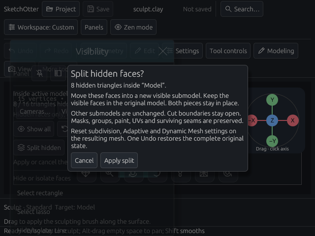
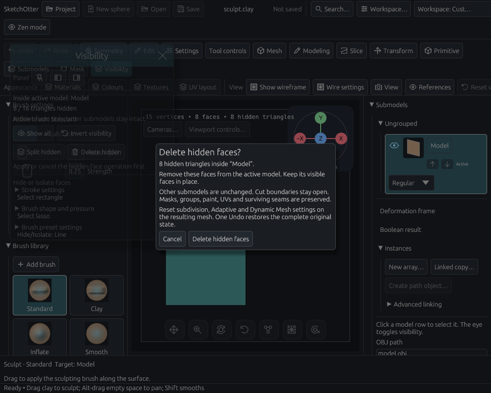

# Visible grouping, Split hidden and Delete hidden

Implements #172, #174 and #173 together on main `d8576f4`.

## Existing behavior and changes

Split hidden already classified effective face visibility (explicit hiding plus
selection-group visibility), kept both pieces in place, copied masks, group
weights/labels, vertex materials, UV corners/masks/removed flags and texture
assignments, retained complete quads and crease edges, reset the mesh settings,
and provided one-step history. It did not need another splitting engine.

The extraction helper did lose explicit UV seam marks and Boolean shading
seams. It now remaps those edges onto surviving topology. Stale UV layouts and
loose modeling geometry are rejected before changing the document. Assigned
images also survive extraction before unwrapping; their identity and pixel data
remain shared.

Group all now assigns visible faces and their vertices across all stored levels.
Hidden-only vertices receive no new membership. Shared boundary vertices join
the new group while retaining all previous hidden-region weights. Existing
hidden labels and group visibility are preserved, and selection-group compaction
uses one registry across levels. Non-selection density channels are retained,
including empty channels. A fully replaced group's name/slot can be reused;
a group still owning hidden data cannot be overwritten by reusing its name.
All-hidden or whole-model-hidden input leaves history and Redo intact.

Delete hidden uses the same extraction, keeps the visible surface and shared
boundary vertices, removes unused vertices from the deleted part, and leaves
open cuts. No hidden faces is a no-op. All-hidden input is rejected so the user
can reveal a surface to keep or deliberately delete the whole submodel.

Both operations are searchable/configurable actions. Menu, search and dispatcher
use the same availability checks, including the active model, Thickness,
visible/hidden face counts, loose geometry, stale UVs and Split's 64-model limit.
The dialog names the target and count, explains the current-level/settings
reset, and offers Apply/Cancel. Escape cancels. Source-revision and target checks
reject stale confirmations. Modal input cannot sculpt or dispatch unrelated edits.

## Validation scope

Focused regressions cover explicit and group hiding, shared boundaries,
disconnected components, stored levels, density and nonuniform masks/materials,
UV/shading seam remapping, preserved image identities, complete quads, unsupported
inputs, no-op/failed-operation Redo preservation, exact Undo/Redo and JSON project
reopening. UI checks exercise real menu and dialog buttons, search dispatch,
shortcut persistence, stale confirmations and compact layouts.

Local validation passed **20 focused checks** plus the ignored Vulkan interaction
review (four cases: Split/Delete at 1000×800 and 640×480). The final CPU run took
9.26 s and the rendered run 19.80 s; these are test durations, not performance
claims. Vulkan used llvmpipe, Mesa 26.3.1 / LLVM 23.1.5, with one software-rendering
thread. The compact and normal confirmation images were visually inspected:
target/count, consequences and both action buttons fit and remain readable.

The control test first caught Split hidden below the pinned menu's initial
scroll area. The target, restore and split/delete actions now precede the
selection tools, and the actual clicks pass at both sizes. General floating
viewport controls can still overlap portions of a restored pinned menu; this
change does not claim to resolve the broader menu-placement system in #50.
The reviewed confirmations and Split/Delete buttons remain reachable.

Final review also covered a deletion with only UV seam marks on the removed
faces, before unwrapping. Delete uses the same installation path as Split so
the generic geometry commit cannot restore those deleted-only marks.

The 8 GB laptop had about 1.7 GiB available at the first build. A 102-test staged
selection hit a 1,500 MiB cgroup cap; it was not retried unchanged. The reduced
selection (ultimately 21 cases including the optional capture) compiled with
one job, debug symbols/incremental compilation disabled, 256 codegen units,
a 1,400 MiB cap and no cgroup swap. All heavy commands used the shared build
lock. This used the existing temporary test-staging technique; the supported
partition requested in #176 remains separate. No staging changes are shipped.

Ordinary CI keeps the complete application suite. The added GPU CI check clicks the actual
Split/Delete/Cancel controls and checks document/history results; its screenshots
are supplementary visual evidence, not an automatic visual-correctness oracle.

Native tablet pressure/device coverage is not claimed by the offscreen primary
pointer checks. These operations use the ordinary mouse/pen button path and do
not depend on pressure. No capacity, solver, retopology partition or repaint
scheduling work is included.


## Reproduction and visual evidence

On a host with enough memory for the full application harness, run these focused
filters sequentially under the shared build lock after checking RAM/pressure:

```sh
cargo test --locked -j 1 --lib visibility_ -- --test-threads=1
cargo test --locked -j 1 --lib group_all_ -- --test-threads=1
CLAY_GPU_SOFTWARE=1 LP_NUM_THREADS=1 CLAY_GUIDE_PREVIEW=/tmp/clay-visibility-review cargo test --locked -j 1 --lib visibility_edits_offscreen_review -- --ignored --test-threads=1
```

A Cargo name filter still compiles the full harness. On a constrained laptop,
use CI for that compilation rather than assuming the filter limits memory.




